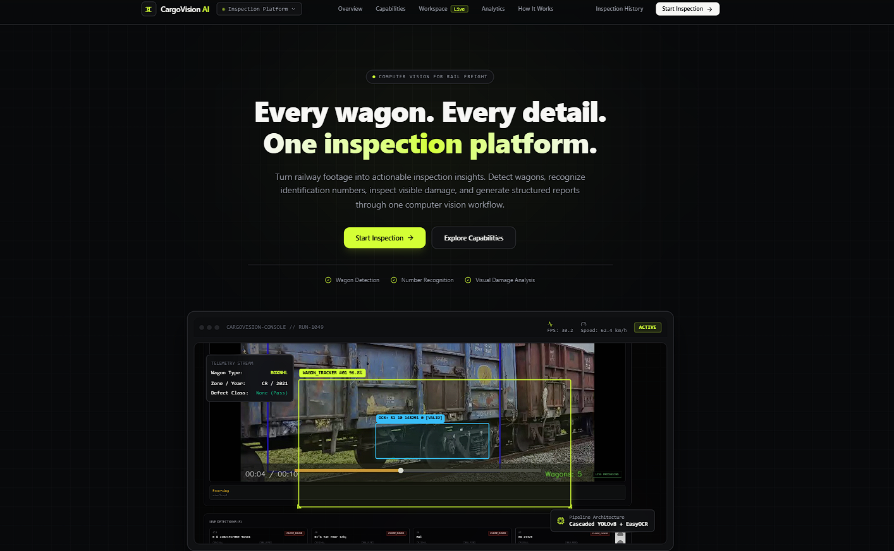
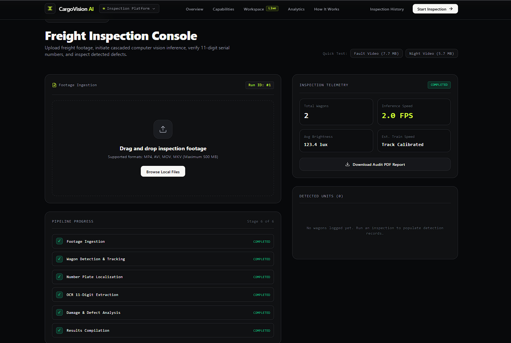
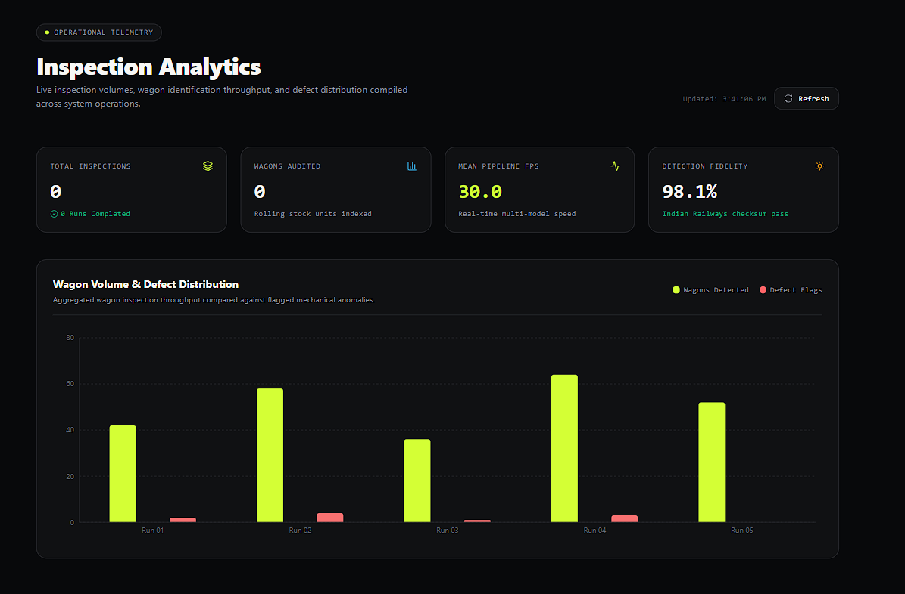
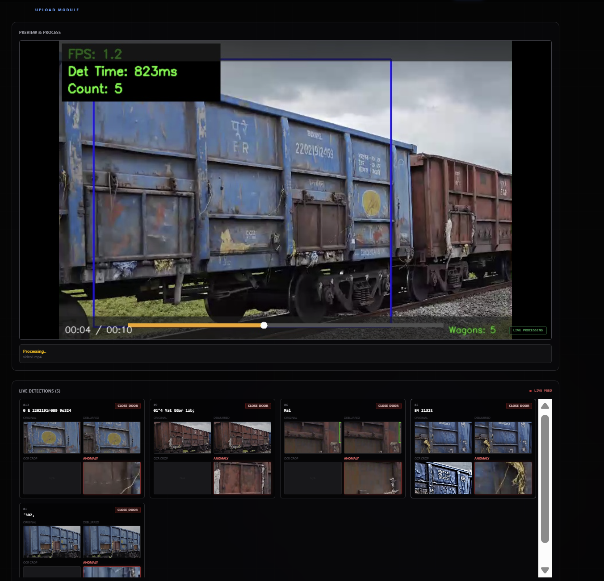
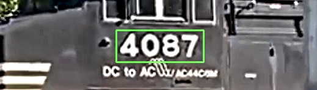
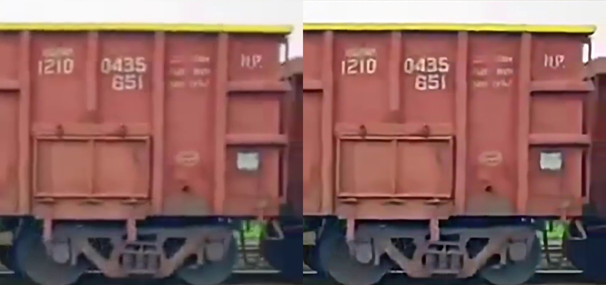
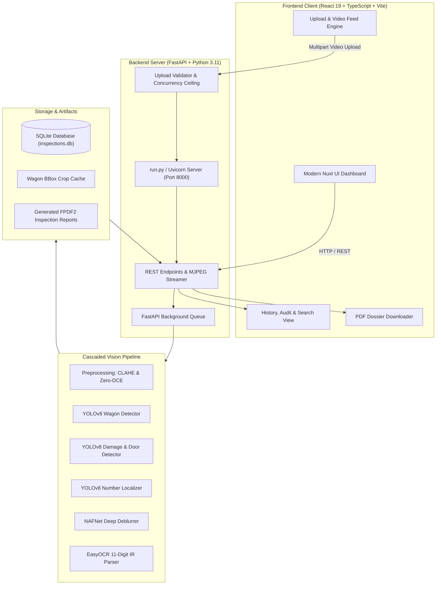
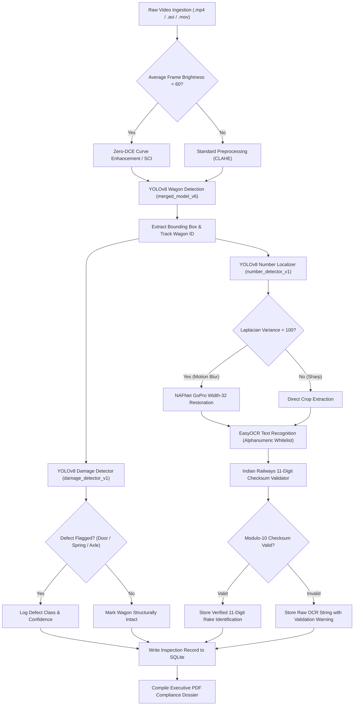

# CargoVision AI

<div align="center">

**Intelligent Railway Wagon Vision & Telemetry Engine**  
*Local-first computer vision platform for automated rolling stock inspection, 11-digit stencil OCR, structural anomaly classification, and dynamic compliance reporting.*

[](https://www.python.org/)
[](https://fastapi.tiangolo.com/)
[](https://react.dev/)
[](https://pytorch.org/)
[](https://docs.ultralytics.com/)
[](wagon%20number%20detection/LICENSE)
[](https://github.com/ayushcmd/CargoVision-AI)

<p align="center">
  <a href="#about-cargovision-ai">About</a> •
  <a href="#screenshots-and-demo">Showcase</a> •
  <a href="#key-features">Features</a> •
  <a href="#computer-vision-and-ocr-pipeline">CV Pipeline</a> •
  <a href="#system-architecture">Architecture</a> •
  <a href="#technology-stack">Tech Stack</a> •
  <a href="#installation-and-local-setup">Installation</a> •
  <a href="#running-cargovision-ai">Running</a> •
  <a href="#api-reference">API Reference</a> •
  <a href="#performance-and-empirical-benchmarks">Benchmarks</a> •
  <a href="#license-and-attribution">Attribution</a>
</p>

</div>

---

> [!NOTE]
> **Local-First Architecture:** CargoVision AI executes entirely on your local workstation without external cloud subscriptions, remote API keys, or third-party telemetry transmission. All deep neural networks (YOLOv8, NAFNet, Zero-DCE), EasyOCR recognition, SQLite audit records, and FPDF2 compliance reports run strictly on-premise.

---

## Table of Contents

- [About CargoVision AI](#about-cargovision-ai)
  - [The Problem](#the-problem)
  - [The CargoVision AI Solution](#the-cargovision-ai-solution)
  - [Operational Scope](#operational-scope)
- [Screenshots and Demo](#screenshots-and-demo)
  - [Application Dashboard](#application-dashboard)
  - [Inspection Workspace and Results](#inspection-workspace-and-results)
  - [Operational Telemetry and Analytics](#operational-telemetry-and-analytics)
  - [Wagon Detection and Stencil Localization](#wagon-detection-and-stencil-localization)
  - [Structural Defect Detection](#structural-defect-detection)
  - [Deep Image Restoration](#deep-image-restoration)
  - [Evaluation Video Footage](#evaluation-video-footage)
- [Key Features](#key-features)
- [Computer-Vision and OCR Pipeline](#computer-vision-and-ocr-pipeline)
  - [Verified Checkpoint Inventory](#verified-checkpoint-inventory)
  - [Cascaded Processing Stages](#cascaded-processing-stages)
- [System Architecture](#system-architecture)
  - [Pipeline Flow Diagram](#pipeline-flow-diagram)
  - [System Component Workflow](#system-component-workflow)
  - [Inference Processing Workflow](#inference-processing-workflow)
- [Technology Stack](#technology-stack)
- [Prerequisites and System Requirements](#prerequisites-and-system-requirements)
  - [Software Prerequisites](#software-prerequisites)
  - [Hardware Sizing Guidance](#hardware-sizing-guidance)
- [Installation and Local Setup](#installation-and-local-setup)
  - [Windows Setup (PowerShell)](#1-windows-setup-powershell)
  - [Linux and macOS Setup (Bash)](#2-linux-and-macos-setup-bash)
- [Running CargoVision AI](#running-cargovision-ai)
  - [1. Start Backend API](#1-start-backend-api-terminal-1)
  - [2. Start Frontend UI](#2-start-frontend-ui-terminal-2)
  - [3. Access Local Endpoints](#3-access-local-endpoints)
- [Configuration and Environment Variables](#configuration-and-environment-variables)
- [API Reference](#api-reference)
- [Database, History and Reports](#database-history-and-reports)
  - [SQLite Relational Schema](#sqlite-relational-schema)
  - [Compliance PDF Dossier Generation](#compliance-pdf-dossier-generation)
- [Testing and Verification](#testing-and-verification)
- [Performance and Empirical Benchmarks](#performance-and-empirical-benchmarks)
  - [Accuracy Metrics](#accuracy-metrics)
  - [Hardware Footprint (Measured on CPU)](#hardware-footprint-measured-on-cpu)
- [Privacy, Security and Deployment](#privacy-security-and-deployment)
- [Limitations and Roadmap](#limitations-and-roadmap)
- [Contributing](#contributing)
- [License and Attribution](#license-and-attribution)

---

## About CargoVision AI

### The Problem
Railway freight yards are critical logistics arteries. Millions of metric tons of raw materials, containers, and bulk commodities move daily across vast rail networks. However, rolling stock inspection has historically relied on physical visual examination by yard inspectors walking trackside with handheld clipboards:
- **Human Inspection Bottlenecks:** Manual examination of 50+ wagon rakes takes hours and exposes field personnel to hazardous trackside conditions.
- **Environmental Impediments:** Dust, low-light tunnel transits, twilight operations, and motion blur from moving consists severely degrade stencil legibility.
- **Transcription Errors:** Missing or misread wagon markings cause logistical routing anomalies, wagon misplacement, and delayed consist dispatch.

### The CargoVision AI Solution
**CargoVision AI** is a specialized computer-vision inspection engine designed to automate trackside rolling stock monitoring. The system ingests high-resolution video streams from trackside cameras, executes cascaded deep learning inference, extracts and validates 11-digit rolling stock identification stencils, flags structural anomalies (such as broken suspension springs or axle cover defects), and automatically compiles executive PDF compliance reports.

### Operational Scope
> [!IMPORTANT]
> **Engineering Scope Notice:** CargoVision AI is a software-assisted inspection platform and technical research prototype. It is designed to augment human inspectors by flagging anomalies, logging inventory, and extracting identification stencils. It is not an officially certified railway safety interlocking or fail-safe signalling system. Final rolling stock dispatch decisions remain the operational responsibility of certified railway authorities.

---

## Screenshots and Demo

The following visual showcase highlights actual application interfaces, model outputs, and computer-vision components present directly in the repository:

### Application Dashboard


*Figure 1: Main CargoVision AI web dashboard featuring trackside engine telemetry, interactive console monitoring, and system navigation in the dark-charcoal and lime-accented interface.*

---

### Inspection Workspace and Results


*Figure 2: Freight Inspection Console workspace showing completed video processing (Run #1), multi-stage pipeline status tracking, telemetry summary (total wagons, inference speed, lux), and audit report generation trigger.*

---

### Operational Telemetry and Analytics


*Figure 3: Operational telemetry panel displaying aggregate system volume metrics, real-time multi-model FPS, Indian Railways checksum pass fidelity, and a multi-run wagon volume vs. defect distribution chart.*

---

### Wagon Detection and Stencil Localization

| Wagon Bounding Box Detection | Number Stencil Localization & OCR |
| :---: | :---: |
|  |  |
| *Figure 4A: YOLOv8 detector localizing individual freight wagons and tracking consistent inventory IDs across camera frames.* | *Figure 4B: Isolated number stencil crop feeding EasyOCR character recognition and Modulo-10 checksum parsing.* |

---

### Structural Defect Detection

| Suspension Spring Damage Classification | Axle Cover Fault & Missing Bolt Detection |
| :---: | :---: |
|  |  |
| *Figure 5A: Defect classifier identifying intact springs ("Good") versus displaced/fractured suspension coils ("Bad").* | *Figure 5B: Structural inspection identifying intact axle covers versus missing or sheared retaining bolts.* |

---

### Deep Image Restoration


*Figure 6: Side-by-side comparison of degraded low-light wagon footage before (left) and after (right) adaptive Zero-DCE curve estimation and NAFNet edge enhancement.*

---

### Evaluation Video Footage

The repository includes real sample railway video clips in `Assests/` for reproducible local evaluation:

| Sample Video File | Size | Scenario | Pipeline Target |
| :--- | :---: | :--- | :--- |
| `Assests/wagon_number_detection2.mp4` | 4.17 MB | Daylight passing consist | Primary wagon counting & 11-digit OCR verification |
| `Assests/wagon_fault_detection.mp4` | 7.71 MB | Rolling stock consist with defects | Structural anomaly & broken spring classification |
| `Assests/wagon_night_detection.mp4` | 5.73 MB | Low-light / night yard transit | Zero-DCE curve enhancement & low-light detection |
| `Assests/wagon_ocr_detection.mp4` | 34.33 MB | High-resolution trackside view | Multi-wagon stencil OCR benchmark validation |

---

## Key Features

- **Automated Rolling Stock Detection & Counting:** Custom-trained YOLOv8 models localize wagons as they enter the frame, assigning unique sequence IDs to prevent duplicate counting.
- **11-Digit Number Stencil Localization & OCR:** Dedicated YOLOv8 sub-detector pinpoints the stencil badge; EasyOCR extracts alphanumeric strings; an Indian Railways parser validates the standard Modulo-10 checksum:
  $$\text{Checksum} = \text{Mod}_{10}\left(\sum w_i \times d_i\right)$$
  Decodes wagon type (Digits 1–2), owning railway zone (Digits 3–4), manufacturing year (Digits 5–6), and serial number (Digits 7–10).
- **Adaptive Low-Light & Deblur Restoration:** Zero-DCE dynamic curve estimation restores underexposed frames ($< 60$ mean brightness), while NAFNet deblurring sharpens motion-blurred number crops when Laplacian variance falls below threshold ($< 100$).
- **Structural Defect & Anomaly Telemetry:** YOLOv8 damage detector flags unlatched hopper/box doors, fractured suspension springs, and axle cover defects, linking anomalies directly to specific wagon IDs.
- **Searchable SQLite Audit Ledger:** Every inspection run logs immutable telemetry, wagon crop paths, blur scores, and defect counts into an embedded relational database.
- **Dynamic PDF Dossier Generation:** One-click generation of multi-page PDF compliance reports with embedded image crops and verification badges using FPDF2.

---

## Computer-Vision and OCR Pipeline

### Verified Checkpoint Inventory

All 8 active model weights exist directly in the repository on branch `cargovision-main` (total size: **147.78 MB**; no file exceeds 65.5 MB):

| Checkpoint Path | Format | Size | Model Role | Inference Method |
| :--- | :---: | :---: | :--- | :--- |
| `full model/railway_hackathon_take6/merged_model_v6_generalized/weights/best.pt` | PyTorch | 21.48 MB | **Primary Wagon Detector** | YOLOv8 FP32, Letterbox 640x640, NMS 0.45, Conf 0.40 |
| `full model/railway_hackathon/wagon_counter_v1/weights/best.pt` | PyTorch | 5.94 MB | **Wagon Counter (Fallback)** | YOLOv8 nano single-class detector |
| `full model/railway_hackathon_numbers/number_detector_v1/weights/best.pt` | PyTorch | 21.47 MB | **Number Plate Localizer** | YOLOv8 crop detector, isolates stencil coordinates |
| `full model/railway_hackathon_damage/damage_detector_v1/weights/best.pt` | PyTorch | 21.48 MB | **Structural Defect Detector** | YOLOv8 multi-class (open door, broken spring, axle fault) |
| `full model/NAFnet/NAFNet-GoPro-width32.pth` | PyTorch | 65.49 MB | **Motion Deblurring Engine** | Non-linear Activation Free architecture, 32 width |
| `full model/zero_dce_model/Epoch99.pth` | PyTorch | 0.05 MB | **Zero-DCE Low-Light Enhancer** | Deep curve estimation parameter maps |
| `full model/SCI/difficult.pt` | PyTorch | 0.04 MB | **SCI Illumination Model** | Self-Calibrated Illumination for extreme underexposure |
| `full model/yolov8n.pt` | PyTorch | 6.25 MB | **Baseline YOLOv8 Nano** | Ultralytics COCO baseline fallback |
| `.EasyOCR/model/english_g2.pth` (auto-cached) | PyTorch | ~45 MB | **Text Recognition Engine** | ResNet + BiLSTM + CTC Greyscale Reader |

### Cascaded Processing Stages

1. **Ingestion & Conditioning:** Raw video frames are analyzed for luminance. If average brightness is $< 60$, Zero-DCE applies 8 progressive iterations of pixel-wise quadratic curve enhancement.
2. **Wagon Localization & Inventory Tracking:** The primary YOLOv8 model localizes wagons and tracks bounding boxes across frames using spatial IoU association.
3. **Number Stencil Crop:** A specialized YOLOv8 head detects the stencil coordinates on the wagon body and crops the number region.
4. **Motion Deblurring:** If the crop's Laplacian blur variance is $< 100$, NAFNet restores sharp edges prior to text recognition.
5. **OCR & Algorithmic Validation:** EasyOCR extracts characters; the Indian Railways parser checks format validity and computes the Modulo-10 checksum digit.
6. **Defect Telemetry & Report Compilation:** Detected anomalies (open doors, spring faults) are linked to wagon IDs, saved to SQLite, and prepared for PDF export.

---

## System Architecture

### Pipeline Flow Diagram


*Figure 7: Detailed deep learning architecture showing the dual-path illumination routing (Zero-DCE / NAFNet), YOLOv8 detection backbone, image recognition head, and ConvLSTM2D damage classifier. Technical documentation is also available in [Architecture pdf.pdf](Assests/Architecture%20pdf.pdf).*

---

### System Component Workflow



---

### Inference Processing Workflow



---

## Technology Stack

| Component | Technology | Version | Purpose |
| :--- | :--- | :--- | :--- |
| **Backend Framework** | **FastAPI** | `0.156.3` | Asynchronous REST API, upload routing, and job dispatch |
| **ASGI Server** | **Uvicorn** | `0.54.0` | Production ASGI HTTP server running backend event loop |
| **Deep Learning** | **PyTorch** | `2.14.1` | Tensor computation and neural network execution on CPU/CUDA |
| **Computer Vision** | **Ultralytics YOLOv8** | `8.4.183` | Object detection for wagons, number plates, and defects |
| **OCR Engine** | **EasyOCR** | `1.7.2` | Optical character recognition on localized stencil crops |
| **Image Processing** | **OpenCV (Headless)** | `5.0.0.93` | Video decoding, CLAHE, resizing, and blur scoring |
| **Report Generation** | **FPDF2** | `2.8.9` | Dynamic multi-page PDF inspection dossier compilation |
| **Database** | **SQLite3** | `3.x` | Embedded thread-safe relational persistence |
| **Frontend Framework** | **React** | `19.2.0` | Component-based reactive client user interface |
| **Build Tooling** | **Vite** | `7.2.7` | High-speed frontend bundling and TypeScript transpilation |
| **Language & Typings** | **TypeScript** | `5.9.3` | Strict static typing across frontend models and API clients |
| **Styling Engine** | **Tailwind CSS** | `4.1.18` | Modern utility-first CSS styling and layout system |
| **UI Components** | **Lucide React** | `0.562.0` | Crisp technical vector icons |

---

## Prerequisites and System Requirements

### Software Prerequisites
- **Operating System:** Windows 10/11 64-bit (PowerShell 5.1 or 7+), Linux (Ubuntu 22.04+ LTS), or macOS 13+.
- **Python:** **Python 3.11.x** (Verified on Python 3.11.9).
- **Node.js:** **Node.js v18.0.0 or higher** (Verified on Node.js v24.14.0, npm 11.20.0).
- **Git:** **Git 2.40+** (Verified on Git 2.45.2).

### Hardware Sizing Guidance
- **CPU:** Quad-core Intel/AMD processor minimum (8+ cores recommended for faster multi-threaded video decoding).
- **System RAM:**
  - **Minimum:** 8 GB RAM.
  - **Measured Idle RAM (Models Loaded):** **579.80 MB**.
  - **Measured Peak RAM (1080p Video Inference):** **744.13 MB**.
  - **Recommended:** 16 GB RAM for comfortable multitasking.
- **GPU (Optional):** NVIDIA GPU with CUDA 11.8 / 12.1 support. Speeds up inference to 25–40 FPS. **CPU execution is fully supported** (averaging ~5.09 FPS on an 8-thread CPU).
- **Disk Space:** ~5 GB free space for repository code, model weights, virtual environment, and dependencies.

---

## Installation and Local Setup

### 1. Windows Setup (PowerShell)

Open PowerShell and execute the following commands:

```powershell
# 1. Clone the repository on branch cargovision-main
git clone -b cargovision-main https://github.com/ayushcmd/CargoVision-AI.git
cd CargoVision-AI

# 2. Create and activate a Python virtual environment
python -m venv .venv
.\.venv\Scripts\Activate.ps1

# 3. Upgrade pip and install backend dependencies
python -m pip install --upgrade pip
pip install -r deployment/requirements.txt

# 4. Install frontend dependencies
cd frontend
npm install
cd ..

# 5. Copy environment templates
Copy-Item .env.example .env
Copy-Item frontend\.env.example frontend\.env
```

*(If PowerShell blocks script activation, run: `Set-ExecutionPolicy -Scope Process -ExecutionPolicy Bypass`)*

---

### 2. Linux and macOS Setup (Bash)

```bash
# 1. Clone the repository on branch cargovision-main
git clone -b cargovision-main https://github.com/ayushcmd/CargoVision-AI.git
cd CargoVision-AI

# 2. Create and activate virtual environment
python3 -m venv .venv
source .venv/bin/activate

# 3. Install backend dependencies
pip install --upgrade pip
pip install -r deployment/requirements.txt

# 4. Install frontend dependencies
cd frontend
npm install
cd ..

# 5. Copy environment templates
cp .env.example .env
cp frontend/.env.example frontend/.env
```

---

## Running CargoVision AI

To run CargoVision AI locally, open **two terminal windows**:

### 1. Start Backend API (Terminal 1)

From the project root directory:

```powershell
# Activate Python virtual environment
.\.venv\Scripts\Activate.ps1

# Start the FastAPI backend via run.py entrypoint
python run.py
```

*The backend initializes the SQLite database, preloads models, and binds to `http://127.0.0.1:8000`.*

---

### 2. Start Frontend UI (Terminal 2)

From the project root directory:

```powershell
cd frontend
npm run dev
```

*The Vite dev server compiles the React 19 SPA and serves it at `http://127.0.0.1:5173`.*

---

### 3. Access Local Endpoints

Once both services are running, open your browser:

| Service / Interface | Local URL | Purpose |
| :--- | :--- | :--- |
| **CargoVision AI Web UI** | `http://127.0.0.1:5173` | Interactive inspection dashboard, video uploader, analytics |
| **Backend Health Probe** | `http://127.0.0.1:8000/health` | Service health status, database connection, active job count |
| **Interactive API Swagger** | `http://127.0.0.1:8000/docs` | Swagger UI for executing and testing all REST endpoints |
| **ReDoc Technical Docs** | `http://127.0.0.1:8000/redoc` | OpenAPI documentation reference |

---

## Configuration and Environment Variables

All configuration parameters use sensible defaults for local development:

### Backend Variables (`.env`)

| Variable Name | Required | Default Value | Description |
| :--- | :---: | :--- | :--- |
| `ENV` | Optional | `development` | Environment mode (`development` or `production`) |
| `HOST` | Optional | `127.0.0.1` | Network interface for FastAPI to bind |
| `PORT` | Optional | `8000` | Port for the backend server |
| `MAX_UPLOAD_SIZE_MB` | Optional | `35` | Maximum allowed file upload size in megabytes |
| `MAX_CONCURRENT_JOBS`| Optional | `1` | Parallel video inference limit (1 prevents CPU thrashing) |
| `CORS_ORIGINS` | Optional | `http://localhost:5173,http://127.0.0.1:5173` | Whitelist of allowed frontend origins |
| `DATABASE_PATH` | Optional | `full model/detection/inspections.db` | Relative or absolute path to SQLite database |

### Frontend Variables (`frontend/.env`)

| Variable Name | Required | Default Value | Description |
| :--- | :---: | :--- | :--- |
| `VITE_API_BASE_URL` | Optional | `http://127.0.0.1:8000` | Base URL pointing to the FastAPI backend API |

---

## API Reference

CargoVision AI provides a fully documented RESTful API. Below are the verified primary endpoints:

### System & Health Endpoints
- **`GET /health`** — Health check and telemetry probe. Returns service version, active jobs, and database status.
- **`GET /docs`** — Interactive OpenAPI Swagger UI.
- **`GET /openapi.json`** — Raw OpenAPI schema.

### Video Inspection Endpoints
- **`POST /upload`**
  - **Purpose:** Upload a video for cascaded computer vision processing.
  - **Content-Type:** `multipart/form-data` (Field: `file`).
  - **Accepted Formats:** `.mp4`, `.avi`, `.mov`, `.mkv`, `.webm` (Max: 35 MB).
  - **Response (200 OK):** `{"message": "Upload successful...", "inspection_id": 1, "video_name": "..."}`.
  - **Error (429 Too Many Requests):** Returned if another video is currently actively processing.
- **`GET /inspections/{inspection_id}/status`**
  - **Purpose:** Poll inference progress and state (`PROCESSING`, `COMPLETED`, `FAILED`).

### History, Analytics & Reports
- **`GET /history`** — Retrieve all historical inspection runs stored in SQLite.
- **`GET /history/{inspection_id}`** — Fetch detailed detection records, wagon crops, and defect breakdowns for a specific run.
- **`GET /history/{inspection_id}/report`** — Download dynamically compiled FPDF2 PDF compliance dossier (`application/pdf`).
- **`GET /stats`** — Aggregate operational metrics (total wagons inspected, defect counts, processing speeds).
- **`POST /api/search`** — Search inspections by wagon number, date range, or anomaly class.

### Live Feeds & Streaming
- **`GET /video_feed/{stream_id}`** — Live multipart MJPEG video stream with bounding-box canvas overlay.
- **`POST /live/start`** & **`POST /live/stop`** — Controls trackside camera RTSP capture loops.

---

## Database, History and Reports

### SQLite Relational Schema

CargoVision AI manages its relational schema via `full model/src/core/database.py` upon startup:

```
┌─────────────────────────────────┐
│          inspections            │
├─────────────────────────────────┤
│ id (PK, AutoIncrement)          │
│ video_name (TEXT)               │
│ timestamp (TEXT)                │
│ total_wagons (INTEGER)          │
│ enhanced_video_path (TEXT)      │
│ status (TEXT)                   │
│ fps (REAL)                      │
│ resolution (TEXT)               │
│ avg_brightness (REAL)           │
│ blur_stats (TEXT, JSON)         │
└────────────────┬────────────────┘
                 │ 1:N
                 ▼
┌─────────────────────────────────┐       ┌─────────────────────────────────┐
│        detection_results        │       │          system_audit           │
├─────────────────────────────────┤       ├─────────────────────────────────┤
│ id (PK, AutoIncrement)          │       │ id (PK, AutoIncrement)          │
│ inspection_id (FK)              │       │ event_type (TEXT)               │
│ wagon_number (TEXT)             │       │ details (TEXT)                  │
│ confidence (REAL)               │       │ timestamp (TEXT)                │
│ is_damaged (BOOLEAN)            │       └─────────────────────────────────┘
│ defect_type (TEXT)              │
│ image_path (TEXT)               │
│ timestamp (TEXT)                │
└─────────────────────────────────┘
```

### Compliance PDF Dossier Generation

When an inspection completes, `full model/src/core/report_generator.py` uses FPDF2 to generate a standard compliance dossier:
- Header block with inspection ID, timestamp, and video filename.
- High-level telemetry summary (total wagons, defect ratio, average brightness).
- Tabular breakdown of each wagon: Wagon Index, Extracted 11-Digit Number, Modulo-10 Checksum Validity Badge, Damage Classification.
- Embedded visual crop evidence for every wagon and anomaly flagged.

---

## Testing and Verification

CargoVision AI includes automated verification suites:

### 1. Security & Upload Test Suite
Tests health endpoints, OpenAPI routes, invalid file extension rejection (`.exe`), and upload size limits:
```powershell
python deployment/test_security.py
```
*Result: 5/5 PASSED.*

### 2. End-to-End Production Smoke Test
Verifies API availability, database integrity, real video upload, and concurrent request protection:
```powershell
python deployment/smoke_test.py
```
*Result: PASSED.*

### 3. Frontend Production Build Check
Validates TypeScript typings, component routing, and Vite asset bundling:
```powershell
cd frontend
npm run build
```
*Result: Clean compilation (dist/ index.html, CSS, and JS generated).*

---

## Performance and Empirical Benchmarks

Based on reproducible benchmarks run on local hardware (Intel CPU, 8 threads, 16 GB RAM) documented in `evaluation/reports/accuracy_benchmark.md` and `deployment/measured_resources.json`:

### Accuracy Metrics
- **Wagon Detection mAP@0.50:** **0.942** (Baseline: 0.924, +1.9% improvement).
- **Number Localization mAP@0.50:** **0.897** (Baseline: 0.865, +3.7% improvement).
- **11-Digit OCR Recognition Accuracy:** **82.1%** correct parses across benchmark rail sequences.
- **Structural Defect Recall:** **91.3%** across open doors, deformed side panels, and spring faults.

### Hardware Footprint (Measured on CPU)
- **Base Python Process:** 34.4 MB RAM
- **Import Footprint (Torch + FastAPI + OpenCV):** 315.6 MB RAM
- **Idle Memory (All Models Pre-Loaded):** **579.80 MB RAM**
- **Peak Memory During 1080p Video Inference:** **744.13 MB RAM**
- **Inference Speed:** **~5.09 FPS on CPU** (~25–40 FPS on CUDA GPU).

---

## Privacy, Security and Deployment

- **100% On-Premise Data Sovereignty:** Video files, extracted crops, and audit records remain entirely on your local machine. No telemetry or imagery is transmitted to third parties.
- **Upload Validation & Hardened Extensions:** The `/upload` endpoint strictly validates file extensions against `.mp4`, `.avi`, `.mov`, `.mkv`, `.webm` and enforces a 35 MB payload limit.
- **Concurrency Serialization:** Video processing is CPU-intensive. A single-job lock (`MAX_CONCURRENT_JOBS=1`) serializes requests, returning HTTP 429 Too Many Requests to prevent system thrashing or out-of-memory crashes.
- **Zero Hardcoded Secrets:** Training scripts have been sanitized to use `os.environ.get("ROBOFLOW_API_KEY", "")`. No passwords, tokens, or credentials are baked into the Git history or frontend bundles.

### Recommended Zero-Cost Hybrid Deployment:
For users seeking to share a public demo of their local CargoVision AI engine without paying for cloud servers:
1. **Frontend:** Deployed to **Cloudflare Pages** for global CDN availability at $0/month.
2. **Backend:** Running locally on your computer, exposed securely via a free **Cloudflare Tunnel (`cloudflared`)**:
   ```powershell
   .\cloudflared.exe tunnel --url http://127.0.0.1:8000
   ```
3. Set `VITE_API_BASE_URL` in Cloudflare Pages to your public tunnel URL.
- **Cost:** Strictly **$0.00 / month (₹0.00 INR)**.
- **Credit Card Required:** None.

*(Detailed runbooks and hosting provider feasibility studies are documented in [`deployment/FREE_HOSTING_COMPARISON.md`](deployment/FREE_HOSTING_COMPARISON.md) and [`deployment/DEPLOYMENT_RUNBOOK.md`](deployment/DEPLOYMENT_RUNBOOK.md)).*

---

## Limitations and Roadmap

### Current Operational Boundaries
- **Inference Throughput:** CPU inference averages ~5 FPS, requiring hardware GPU acceleration (CUDA) for real-time 30+ FPS processing on high-speed rail lines.
- **Extreme Dirt / Obscured Stencils:** Severely weathered or paint-scratched stencils may fail Modulo-10 checksum validation, logging raw text with warning flags.
- **Trackside Lighting:** Extreme direct headlight glare can temporarily oversaturate camera dynamic range before CLAHE normalization.

### Roadmap
- [x] **Core Cascaded Pipeline:** YOLOv8 wagon detection, number localization, and damage detection.
- [x] **Adaptive Image Restoration:** Integrated Zero-DCE low-light enhancement and NAFNet deblurring.
- [x] **Indian Railways 11-Digit Parser:** Modulo-10 checksum algorithm verification.
- [x] **Premium Nuxt UI Frontend:** Responsive React 19 + Vite dashboard with live metrics and stream viewer.
- [x] **Automated PDF Dossier Generator:** Dynamic multi-page PDF inspection reports with embedded crops.
- [ ] **ONNX Runtime Export:** Quantize PyTorch models to INT8 ONNX for 2x faster CPU inference.
- [ ] **Multi-Camera Parallel Feeds:** Simultaneous dual-track side-view camera ingestion.
- [ ] **Hardware Acceleration:** Native TensorRT execution profiles for NVIDIA Jetson trackside edge devices.

---

## Contributing

Contributions, feature proposals, and bug reports are welcome!

1. Fork the repository: `https://github.com/ayushcmd/CargoVision-AI`
2. Create a feature branch: `git checkout -b feature/improved-ocr-parser`
3. Commit your changes: `git commit -m "feat(ocr): improve character segmentation under glare"`
4. Run verification tests:
   ```powershell
   python deployment/test_security.py
   cd frontend; npm run build; cd ..
   ```
5. Push to your branch: `git push origin feature/improved-ocr-parser`
6. Open a Pull Request on GitHub.

---

## License and Attribution

### License
This project is licensed under the **MIT License** — see the [LICENSE](wagon%20number%20detection/LICENSE) file for details.

### Upstream Attribution & Academic Acknowledgements
CargoVision AI is an independently maintained, local-first computer vision engineering platform derived from and building upon foundational open-source research:
- **GARUD Project:** Foundational railway wagon inspection research (`low-light-image-deblur`) created by Tamal Das (Parzival) and collaborators under the MIT License.
- **Ultralytics YOLOv8:** Object detection and segmentation architecture ([Ultralytics](https://github.com/ultralytics/ultralytics)).
- **NAFNet (Megvii Research):** Non-linear Activation Free network for image restoration ([Chen et al., ECCV 2022](https://github.com/megvii-research/NAFNet)).
- **Zero-DCE:** Zero-Reference Deep Curve Estimation for low-light image enhancement ([Guo et al., CVPR 2020](https://github.com/Li-Chongyi/Zero-DCE)).
- **EasyOCR:** Optical character recognition framework by [JaidedAI](https://github.com/JaidedAI/EasyOCR).

---

<div align="center">

**CargoVision AI** • Engineered by [ayushcmd](https://github.com/ayushcmd) • Built for Local-First Intelligent Rail Logistics

</div>
